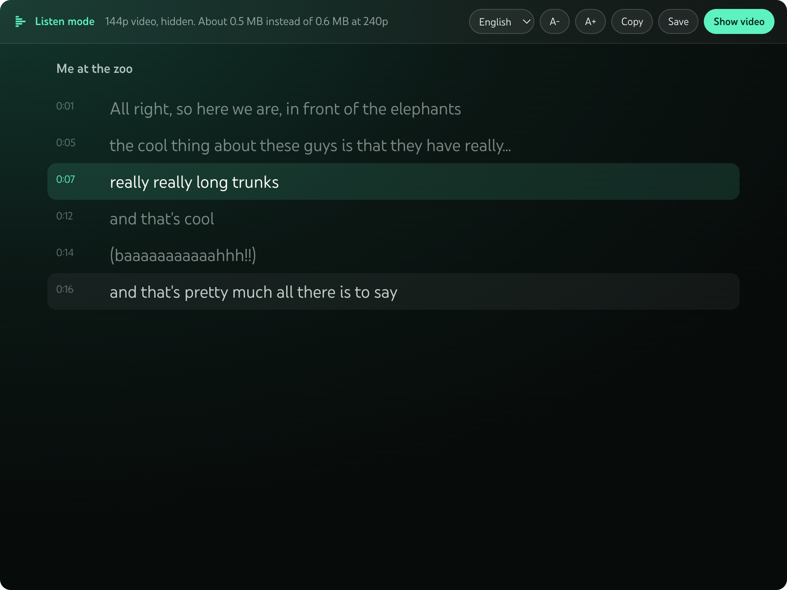
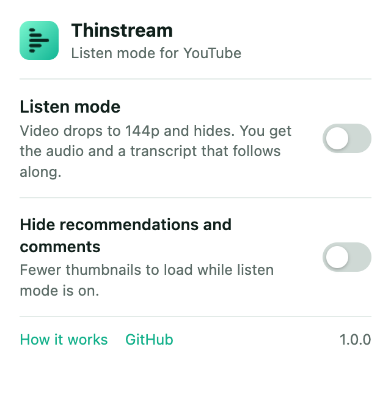

<p align="center">
  
</p>

<h1 align="center">Thinstream: listen mode for YouTube</h1>

<p align="center">
  <b>Listen to YouTube and read the transcript when your internet is slow.</b><br>
  A free browser extension for Chrome, Firefox and Safari. One click drops the video to 144p, hides it, and shows a transcript that follows the audio.
</p>

<p align="center">
  <a href="https://github.com/alireza12t/thinstream/releases/latest">Download</a> ·
  <a href="https://alireza12t.github.io/thinstream/">Website</a> ·
  <a href="#install">Install</a> ·
  <a href="#how-it-compares">Comparison</a> ·
  <a href="#questions">Questions</a>
</p>

<p align="center">
  <a href="https://github.com/alireza12t/thinstream/releases/latest"></a>
  <a href="#chrome-edge-brave-arc-and-other-chromium-browsers"></a>
  <a href="#firefox"></a>
  <a href="#safari-on-mac"></a>
  <a href="#license"></a>
</p>

<p align="center">
  
</p>

## What it does

Sometimes you want a video but the connection can't carry it. Hotel wifi, a train, a phone hotspot, a data cap. Most videos are fine as audio if you can also read along.

Thinstream adds a **Listen mode** button to the YouTube player. Turn it on and:

- The video drops to the lowest quality YouTube offers, 144p, and stays there.
- The picture is hidden, so you are not staring at a blurry frame.
- The full transcript shows in the player. The current line is highlighted and scrolls with the audio.
- Click any line to jump to that moment.
- Pick the caption language, change the text size, copy the transcript, or save it as a `.txt` file.
- The header shows roughly how much data this video needs in listen mode and at normal quality.
- It stays on for the next videos until you press **Show video**.

No account. No server. No tracking. No AI. It works with the captions YouTube already has for the video.

## How much data it saves

These are the file sizes YouTube lists for one real video, [Big Buck Bunny 60fps 4K](https://www.youtube.com/watch?v=aqz-KE-bpKQ) (10 minutes 35 seconds), read from the player on 2026-11-12. Each row is video plus the standard audio track. The range covers the different codecs YouTube can pick.

| How you watch | Data for the whole video | Compared with listen mode |
|---|---|---|
| **Listen mode (144p, hidden)** | **about 15 MB** | |
| 480p | 36 to 43 MB | 2 to 3 times more |
| 720p | 66 to 97 MB | 4 to 6 times more |
| 1080p 60fps | 134 to 268 MB | 9 to 18 times more |

So on this video listen mode uses about 77 to 85 percent less data than 720p.

The gap depends on the video. A calm lecture with a still background compresses well, so the saving is smaller. On [a 3Blue1Brown lecture](https://www.youtube.com/watch?v=aircAruvnKk) the extension showed about 22 MB in listen mode against 60 MB at 720p. The number in the panel is always worked out from the video you are on.

### Is it real audio only?

No, and I would rather say so. YouTube's web player now gets audio and video through one combined streaming request, and the separate audio links that older "audio only" extensions relied on are no longer in the page. So Thinstream uses the player's own quality setting to hold the video at 144p. On the video above, that hidden 144p picture is about 5 MB of the 15 MB. The audio is the rest.

## Install

### Chrome, Edge, Brave, Arc and other Chromium browsers

1. Download `thinstream-chrome-1.0.1.zip` from the [latest release](https://github.com/alireza12t/thinstream/releases/latest) and unzip it.
2. Open `chrome://extensions`.
3. Turn on **Developer mode** (top right).
4. Click **Load unpacked** and pick the unzipped folder.

It is not on the Chrome Web Store yet.

### Firefox

1. Download `thinstream-firefox-1.0.1.zip` from the [latest release](https://github.com/alireza12t/thinstream/releases/latest).
2. Open `about:debugging#/runtime/this-firefox`.
3. Click **Load Temporary Add-on** and pick the zip.

Firefox removes a temporary add-on when it restarts, so you load it again next time. A permanent install needs Mozilla to sign it, and it is not on addons.mozilla.org yet. Needs Firefox 140 or newer.

### Safari on Mac

Safari extensions ship inside a small Mac app, so this one is built with Xcode.

1. Clone this repo.
2. Open `safari/Thinstream/Thinstream.xcodeproj` in Xcode.
3. Pick the **Thinstream (macOS)** scheme, set your own team under Signing, and press Run.
4. In Safari go to Settings, Extensions, turn on **Thinstream**, and allow it on `youtube.com`.

### iPhone and iPad

The same Xcode project has a **Thinstream (iOS)** scheme and it compiles. It has not been tested on a real device yet, so treat it as experimental. It only works on youtube.com in Safari, not inside the YouTube app.

## How to use it

1. Open any YouTube video.
2. Press the Thinstream button in the player controls, next to the captions button. You can also use the toolbar popup.
3. Listen and read. Click a line to jump. Press **Show video** to go back to normal.

The popup also has **Hide recommendations and comments**, which stops those thumbnails from loading while listen mode is on.

<p align="center">
  
</p>

## How it compares

Checked on 2026-11-12 from each tool's own store page or site. If something here is out of date, open an issue and I will fix it.

| Tool | Price | Browsers | Lowers data use | Hides the video | Transcript that follows the audio |
|---|---|---|---|---|---|
| **Thinstream** | Free | Chrome, Firefox, Safari | Yes, holds 144p | Yes | Yes |
| [Audio Only Youtube](https://chromewebstore.google.com/detail/audio-only-youtube/pkocpiliahoaohbolmkelakpiphnllog) | Free | Chrome | Aims for audio only | Yes | No |
| [Music Mode for YouTube](https://chromewebstore.google.com/detail/music-mode-for-youtube/abbpaepbpakcpipajigmlpnhlnbennna) | Free | Chrome, Firefox | Lowers the quality of hidden videos | Yes | No |
| [YouTube Listen Mode](https://chromewebstore.google.com/detail/youtube-listen-mode/pbhfgfcljjildhfdglggpjnahaclpdcj) | Free | Chrome | Yes, a setting drops it to 144p | Yes | No |
| [Transcript Mode for YouTube](https://addons.mozilla.org/en-US/firefox/addon/transcript-mode-for-youtube/) | Free | Firefox, Chrome, Edge and others | Not stated | Not stated, it adds a reading view | Yes |
| [Vinegar](https://apps.apple.com/us/app/vinegar-tube-cleaner/id1591303229) | $1.99 | Safari on iPhone, iPad, Mac | Has an audio only option | Replaces the player | No, subtitles only |
| [Glasp YouTube Summary](https://chromewebstore.google.com/detail/nmmicjeknamkfloonkhhcjmomieiodli) | Free tier, Pro $15 a month | Chrome, Edge, Firefox, Safari | No | No | Yes, with AI summaries |
| YouTube's own [Show transcript](https://support.google.com/youtube/answer/15930243) | Free | All | No | No | Yes |
| [YouTube Premium](https://support.google.com/youtube/answer/6308116) | $15.99 a month | Mostly the mobile apps | Not stated | Background play | No |

What I found when I looked:

- I did not find another extension that does all three: lowest quality, hidden video and a synced transcript. That is the reason this exists.
- YouTube Listen Mode (12 users, version 1.13.0) comes closest to all three. It hides the video and has a setting that drops it to 144p, but it has no transcript. Transcript Mode for YouTube has a synced reading view, but its listing says nothing about lowering quality or hiding the video.
- Audio Only Youtube is the best known one, with 50,000 users. It is rated 1.9 out of 5 on the Chrome Web Store, and its GitHub issue ["Doesn't work at all"](https://github.com/Ashish-Bansal/audio-only-youtube/issues/119) has been open since March 2025.
- Music Mode for YouTube is the closest on data. It is free, well rated, and can lower quality when it hides the video. It has no transcript.

Where the others are better:

- An extension that truly blocks the video stream uses less data than Thinstream when it works, because Thinstream still loads 144p.
- Vinegar is the stronger pick on iPhone and iPad today. It is tested there, and it also removes ads and brings back picture in picture.
- Glasp is better if you want an AI summary of the video.
- YouTube Premium is better if you want offline downloads or background play in the mobile app.

## Questions

**How do I listen to a YouTube video without loading the video?**
Install Thinstream, open the video and press the Listen mode button in the player. The video drops to 144p and is hidden, and you get the audio with a transcript.

**How can I watch YouTube on slow internet or a small data plan?**
Use listen mode. It holds every video at 144p, which on the test video above is about 15 MB for ten minutes instead of 66 to 97 MB at 720p.

**Is there an audio only YouTube extension that still works?**
Thinstream works on YouTube as of 2026-11-12, in Chrome, Firefox and Safari. It isn't true audio only (see below), but it holds the video at 144p and hides it, so you get the audio and a transcript on very little data. The best known audio only extension, Audio Only Youtube, is rated 1.9 out of 5 and has an open "Doesn't work at all" issue. Music Mode for YouTube is another working option, without a transcript. See [How it compares](#how-it-compares).

**Does it download only the audio?**
No. YouTube's web player does not offer a separate audio stream any more, so 144p is the floor. See [Is it real audio only?](#is-it-real-audio-only)

**Can I read a YouTube video instead of watching it?**
Yes. The transcript fills the player, follows the audio, and you can copy it or save it as a text file.

**What if a video has no captions?**
Listen mode still works and the audio keeps playing. The panel tells you there is no transcript. Most videos with speech have automatic captions.

**Does it need YouTube Premium or an account?**
No.

**Does it work in other languages?**
Yes. It lists every caption track the video has, including auto generated ones, and handles right to left languages such as Persian and Arabic.

**Does it block ads?**
No. It does not touch ads.

**Does it collect any data?**
No. It makes no network requests of its own. Your settings and the "data saved" counter stay in your browser. See [PRIVACY.md](PRIVACY.md).

**Why not pick 144p myself in the settings menu?**
You can. Thinstream does it in one click, keeps it for every video, hides the blurry picture, gives you the transcript, and puts your normal quality back when you turn it off.

**Is it free?**
Yes. Free for any noncommercial use. See [License](#license).

## Permissions

| Permission | Why |
|---|---|
| Access to `youtube.com` | To add the button and the transcript panel, and to set the player quality. |
| `storage` | To remember your settings in your browser. |
| `scripting` | Safari only needs this, to reach the YouTube player. |

## How it works

- `extension/src/page.js` runs inside the YouTube page. It asks the player for its lowest quality with the player's own API, turns on the caption track so the player fetches it, and reads that response.
- `extension/src/content.js` draws the panel and the button and keeps settings in sync.
- `extension/popup/` is the toolbar popup.
- `safari/` is the Xcode project that wraps the same `extension/` folder for Safari. Nothing is copied.
- The Firefox build is the same files with a small manifest change, made by `scripts/build.sh`. All three browsers run the same code.

When you turn listen mode off, your earlier quality setting and caption state are put back.

## Build from source

```bash
./scripts/build.sh
```

That writes `dist/thinstream-chrome-1.0.1.zip`, `dist/thinstream-firefox-1.0.1.zip` and the unpacked Firefox build in `dist/firefox/`. There is no build step for the code itself. It is plain JavaScript with no dependencies.

For Safari, open the Xcode project as described in [Install](#install).

## What was tested

- Chrome for Testing with the real extension loaded: button, 144p, hide, restore, popup, and the Safari style loading path.
- The same code on live YouTube in a normal browser session: transcript loading, language switch, click to seek, moving to another video.
- Version 1.0.1 fixes (captions already on, jumping far ahead, quality labels): checked on live YouTube in a normal browser session, then the Chrome and Firefox tests were run again.
- Firefox 160 with the real add-on loaded: button, 144p, hide, restore, the transcript view, click to seek and text size. Mozilla's `web-ext lint` reports no errors. The popup was not opened in Firefox.
- Safari: the Mac and iOS apps compile. The extension has not been run inside Safari yet.

## License

[PolyForm Noncommercial 1.0.0](LICENSE.md). In plain words: anyone can use it, share it and change it for free, as long as it is not for making money. You can't sell it, bundle it into a paid product, or run ads on it. If you want to use it commercially, email alireza.toghiani@icloud.com.

Thinstream is not affiliated with or endorsed by YouTube or Google. YouTube is a trademark of Google LLC.

## Author

Made by Alireza Toghiani.

- YouTube: [@DevMvRick](https://www.youtube.com/@DevMvRick)
- Instagram: [@devmvrick](https://instagram.com/devmvrick)
- GitHub: [alireza12t](https://github.com/alireza12t)
